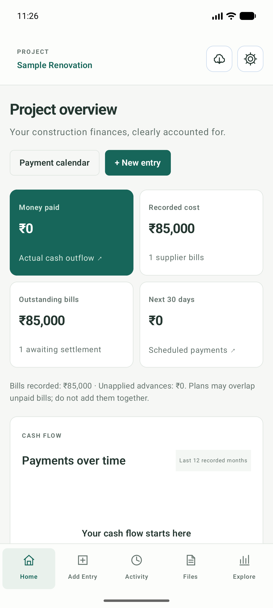
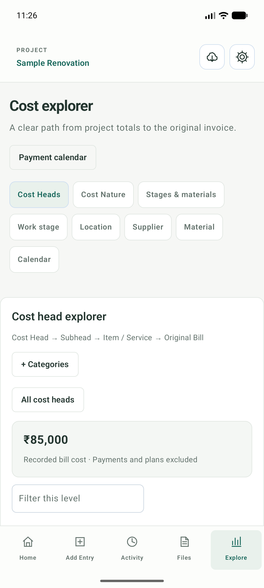
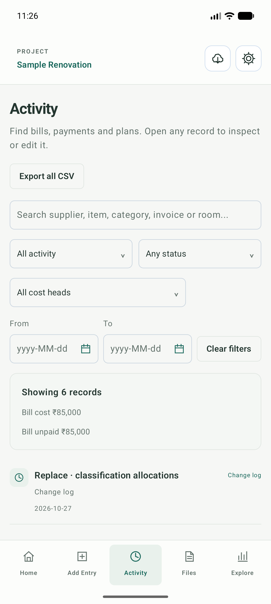

# BuildLedger for Android

BuildLedger is an offline construction-cost and payment ledger. The Android app
uses Kotlin, Jetpack Compose and Room over SQLite. It stores financial records
and original documents in private app storage. Posted amounts are integer paise.

## Scope and boundaries

The working application is `android-native/app/`; the root Gradle project maps
`:app` to that directory. The separate [web application](https://github.com/GurucharanSavanth/BuildLedger)
has its own repository and storage. Android SQLite, web server SQLite and
browser IndexedDB do not synchronize automatically. Back up each installation
independently. Clearing app data or uninstalling Android removes its private
records unless a verified backup can be restored.

## Start and verify

Install Android Studio, JDK 17 and Android SDK 37. The app supports Android 8
(API 26) and later. From the repository root on Windows:

```powershell
.\gradlew.bat :app:assembleDebug
.\gradlew.bat :app:testDebugUnitTest
.\gradlew.bat :app:lintDebug
```

The debug APK is `android-native/app/build/outputs/apk/debug/app-debug.apk`.
Use a disposable device for instrumentation and follow the safeguards in the
[Android guide](android-native/README.md). A production release needs the
owner's permanent signing key; debug and verification APKs are not releases.

## Maintenance map

| Need | Start here |
| --- | --- |
| Build, architecture, storage, backup and release | [Android guide](android-native/README.md) |
| License | [Published license](https://github.com/GurucharanSavanth/ConstructionLedger/blob/main/LICENSE) |

Source and configuration take precedence over documentation. Update the
appropriate guide and dated evidence when behavior, commands or verification
status changes. Preserve original document bytes, financial invariants, audit
history and recovery evidence. Never commit private records, credentials or keys.

The documentation is tailored to this project's scope using NASA's guidance on
maintaining document content and verification evidence; it does not claim NASA
certification or formal compliance. See [NASA documentation guidance](https://swehb.nasa.gov/spaces/SWEHBVB/pages/32604393/SWE-153%2B-%2BETA%2BDefine%2BDocument%2BContent)
and the [NASA Systems Engineering Handbook](https://www.nasa.gov/reference/systems-engineering-handbook/).

## Screenshots

These images use synthetic data.

<p align="center">
  
  
  
</p>
